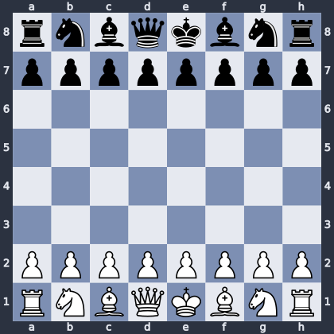

# Hey, I'm Alex 👋

**Software engineer that's always looking for a challenge**

Want to play chess? You're all on the same team, and the team plays against me. Make a move below 👇

<!-- CHESS:START -->
## Play chess against me

**Game 1** · The crowd (you) plays **White**, Alex plays **Black** · 0 moves played

> **Your move!** Click a move below, then press **Submit new issue**. A bot plays it in about a minute.

| Piece | Moves |
| :-- | :-- |
| Knight | [Na3](https://github.com/hergotta24/hergotta24/issues/new?title=chess%7Cmove%7Cb1a3%7C1&body=Just%20press%20%2A%2ASubmit%20new%20issue%2A%2A.%20A%20bot%20will%20play%20the%20move.) [Nc3](https://github.com/hergotta24/hergotta24/issues/new?title=chess%7Cmove%7Cb1c3%7C1&body=Just%20press%20%2A%2ASubmit%20new%20issue%2A%2A.%20A%20bot%20will%20play%20the%20move.) [Nf3](https://github.com/hergotta24/hergotta24/issues/new?title=chess%7Cmove%7Cg1f3%7C1&body=Just%20press%20%2A%2ASubmit%20new%20issue%2A%2A.%20A%20bot%20will%20play%20the%20move.) [Nh3](https://github.com/hergotta24/hergotta24/issues/new?title=chess%7Cmove%7Cg1h3%7C1&body=Just%20press%20%2A%2ASubmit%20new%20issue%2A%2A.%20A%20bot%20will%20play%20the%20move.) |
| Pawn | [a3](https://github.com/hergotta24/hergotta24/issues/new?title=chess%7Cmove%7Ca2a3%7C1&body=Just%20press%20%2A%2ASubmit%20new%20issue%2A%2A.%20A%20bot%20will%20play%20the%20move.) [a4](https://github.com/hergotta24/hergotta24/issues/new?title=chess%7Cmove%7Ca2a4%7C1&body=Just%20press%20%2A%2ASubmit%20new%20issue%2A%2A.%20A%20bot%20will%20play%20the%20move.) [b3](https://github.com/hergotta24/hergotta24/issues/new?title=chess%7Cmove%7Cb2b3%7C1&body=Just%20press%20%2A%2ASubmit%20new%20issue%2A%2A.%20A%20bot%20will%20play%20the%20move.) [b4](https://github.com/hergotta24/hergotta24/issues/new?title=chess%7Cmove%7Cb2b4%7C1&body=Just%20press%20%2A%2ASubmit%20new%20issue%2A%2A.%20A%20bot%20will%20play%20the%20move.) [c3](https://github.com/hergotta24/hergotta24/issues/new?title=chess%7Cmove%7Cc2c3%7C1&body=Just%20press%20%2A%2ASubmit%20new%20issue%2A%2A.%20A%20bot%20will%20play%20the%20move.) [c4](https://github.com/hergotta24/hergotta24/issues/new?title=chess%7Cmove%7Cc2c4%7C1&body=Just%20press%20%2A%2ASubmit%20new%20issue%2A%2A.%20A%20bot%20will%20play%20the%20move.) [d3](https://github.com/hergotta24/hergotta24/issues/new?title=chess%7Cmove%7Cd2d3%7C1&body=Just%20press%20%2A%2ASubmit%20new%20issue%2A%2A.%20A%20bot%20will%20play%20the%20move.) [d4](https://github.com/hergotta24/hergotta24/issues/new?title=chess%7Cmove%7Cd2d4%7C1&body=Just%20press%20%2A%2ASubmit%20new%20issue%2A%2A.%20A%20bot%20will%20play%20the%20move.) [e3](https://github.com/hergotta24/hergotta24/issues/new?title=chess%7Cmove%7Ce2e3%7C1&body=Just%20press%20%2A%2ASubmit%20new%20issue%2A%2A.%20A%20bot%20will%20play%20the%20move.) [e4](https://github.com/hergotta24/hergotta24/issues/new?title=chess%7Cmove%7Ce2e4%7C1&body=Just%20press%20%2A%2ASubmit%20new%20issue%2A%2A.%20A%20bot%20will%20play%20the%20move.) [f3](https://github.com/hergotta24/hergotta24/issues/new?title=chess%7Cmove%7Cf2f3%7C1&body=Just%20press%20%2A%2ASubmit%20new%20issue%2A%2A.%20A%20bot%20will%20play%20the%20move.) [f4](https://github.com/hergotta24/hergotta24/issues/new?title=chess%7Cmove%7Cf2f4%7C1&body=Just%20press%20%2A%2ASubmit%20new%20issue%2A%2A.%20A%20bot%20will%20play%20the%20move.) [g3](https://github.com/hergotta24/hergotta24/issues/new?title=chess%7Cmove%7Cg2g3%7C1&body=Just%20press%20%2A%2ASubmit%20new%20issue%2A%2A.%20A%20bot%20will%20play%20the%20move.) [g4](https://github.com/hergotta24/hergotta24/issues/new?title=chess%7Cmove%7Cg2g4%7C1&body=Just%20press%20%2A%2ASubmit%20new%20issue%2A%2A.%20A%20bot%20will%20play%20the%20move.) [h3](https://github.com/hergotta24/hergotta24/issues/new?title=chess%7Cmove%7Ch2h3%7C1&body=Just%20press%20%2A%2ASubmit%20new%20issue%2A%2A.%20A%20bot%20will%20play%20the%20move.) [h4](https://github.com/hergotta24/hergotta24/issues/new?title=chess%7Cmove%7Ch2h4%7C1&body=Just%20press%20%2A%2ASubmit%20new%20issue%2A%2A.%20A%20bot%20will%20play%20the%20move.) |

How it works

Everyone visiting this page plays together as one side against Alex. Each move link opens a new issue with the move already filled in. Submitting it starts a GitHub Action that checks the move, updates the board image, and rewrites this README. The first legal move wins. Nobody can make two crowd moves in a row. Alex gets pinged on every turn and plays from this same page.

**Alex vs the crowd:** 0 W · 0 L · 0 D

_No crowd moves yet. Be the first!_

♟ Inspired by <a href="https://github.com/timburgan/timburgan">Tim Burgan's community chess game</a> (<a href="https://github.com/timburgan">@timburgan</a>). Thanks, Tim!
<!-- CHESS:END -->

[How the chess bot works](docs/chess.md)
