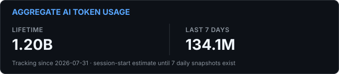

# Alex Hergott

**Software engineer building practical, local-first tools and data-driven applications.**

I focus on projects that solve concrete problems, make complex workflows easier to use, and deepen my engineering skills. I’m currently building Windows productivity software, an NBA simulation platform, and a version-controlled anime review journal while studying Azure fundamentals and expanding my homelab experience.

## Featured work

### Local Dictation for Windows

A local-first push-to-talk dictation app built around offline speech recognition. It emphasizes responsive global hotkeys, visible capture feedback, safe text insertion, and privacy-preserving on-device processing.

**Stack:** C#, .NET, WPF, whisper.cpp, Windows APIs 
**Status:** Active development · source currently private

### Hoops Sim

A possession-level NBA simulator with matchup forecasting, walk-forward model evaluation, saved weekly predictions, and result grading. The project combines statistical modeling with an API and responsive browser interface.

**Stack:** Python, FastAPI, SQLite, JavaScript 
**Status:** Active development · source currently private

### [Anime Tier List](https://github.com/hergotta24/anime-tier-list)

A Markdown-first anime journal where each completed review is version controlled and placed into a personal tier list. Templates make it easy to add ratings without inventing or importing viewing history.

**Stack:** Markdown, Git, GitHub 
**Status:** Initial workflow under review

## What I’m working on

- Shipping reliable local-first Windows tooling
- Improving and validating NBA simulation workflows
- Studying Azure fundamentals and cloud concepts
- Building useful homelab and automation experience
- Turning personal interests into maintainable public projects

## Agent-assisted development

I use AI agents as engineering collaborators for bounded research, implementation, and testing tasks. Automated output is reviewed, exercised, and kept behind the same pull-request approval process as other code.

The widget reports aggregate input, output, cache-read, and cache-write tokens from available agent records. It publishes totals only—never prompts, credentials, costs, model details, or per-agent usage. The seven-day value uses a clearly labeled session-start estimate until seven daily snapshots are available, then switches to snapshot deltas. See the [methodology](docs/token-widget.md).

## Links

<!-- TODO(Alex): Replace these placeholders during PR review. -->
- **Résumé:** Link coming soon
- **LinkedIn:** Link coming soon
- **Portfolio:** Future project
- **Contact:** Preferred public contact method coming soon

---

GitHub’s native contribution graph appears below this profile overview.
